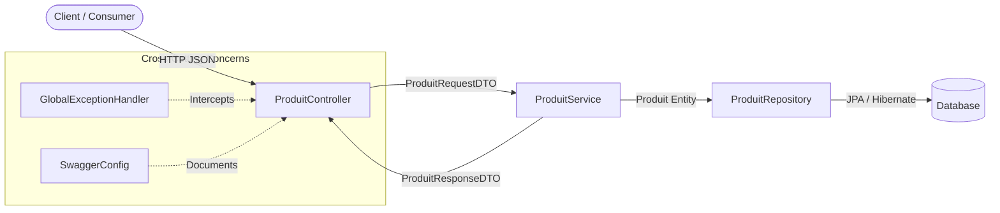

# 🐝 BeeStore — Product Catalog Microservice

**BeeStore** est une API RESTful de gestion de catalogue produits développée par **BeeDigital**. Conçue selon les principes du **Clean Code**, de l'architecture hexagonale/en couches stricte et du **Behavior-Driven Development (BDD)**, cette application garantit une séparation nette des responsabilités, une résilience des erreurs standardisée et une couverture de tests multi-niveaux.

---

## 🏛️ Architecture & Design Patterns

L'application applique une **Architecture en Couches Stricte (Layered Architecture)** où chaque couche communique uniquement avec sa couche adjacente via des contrats (interfaces) et des objets de transfert (DTOs) immuables.



### Décisions Techniques (ADR)

1. **Isolation du Modèle de Domaine (Anti-Corruption Layer)** : 
   * Les entités JPA (`Produit`) ne quittent **jamais** la couche `service`.
   * L'exposition API repose exclusivement sur `ProduitRequestDTO` (entrée avec validation Jakarta) et `ProduitResponseDTO` (sortie), évitant ainsi les vulnérabilités de type *Mass Assignment* et les problèmes de sérialisation *LazyInitializationException*.
2. **Gestion Centralisée des Exceptions (`@RestControllerAdvice`)** :
   * Toute exception métier (ex: `ProduitNotFoundException`) ou erreur de validation (`MethodArgumentNotValidException`) est interceptée par `GlobalExceptionHandler` pour retourner une charge utile JSON standardisée et prédictible.
3. **Inversion de Contrôle (IoC)** :
   * Le couplage entre la couche présentation (`ProduitController`) et la logique métier (`ProduitServiceImpl`) est abstrait par le contrat `ProduitService`, facilitant le mocking et les évolutions futures.

---

## 📂 Topologie du Code Source

```text
src/
├── main/
│   ├── java/com/beedigital/beestore/
│   │   ├── config/
│   │   │   └── SwaggerConfig.java              # Bean de configuration OpenAPI 3.0
│   │   ├── controller/
│   │   │   └── ProduitController.java          # Couche Présentation REST (Validation & Routing HTTP)
│   │   ├── dto/
│   │   │   ├── ProduitRequestDTO.java          # Payload d'entrée (Validation Bean)
│   │   │   └── ProduitResponseDTO.java         # Projection de sortie exposée aux clients
│   │   ├── entity/
│   │   │   └── Produit.java                    # Modèle de persistance relationnel (JPA)
│   │   ├── exception/
│   │   │   ├── GlobalExceptionHandler.java     # Traducteur d'exceptions -> Statuts HTTP
│   │   │   └── ProduitNotFoundException.java   # Exception métier (Domaine)
│   │   ├── repository/
│   │   │   └── ProduitRepository.java          # Abstraction d'accès aux données (Spring Data JPA)
│   │   ├── service/
│   │   │   ├── ProduitService.java             # Interface du domaine métier
│   │   │   └── ProduitServiceImpl.java         # Implémentation transactionnelle (@Transactional)
│   │   └── BeeStoreApplication.java            # Bootstrap Spring Boot
│   └── resources/
│       ├── application.properties              # Configuration socle et sélection de profil
│       ├── application-dev.properties          # Datasource in-memory, logs DEBUG, H2 Console
│       └── application-prod.properties         # Optimisations HikariCP, DDL validate, logs WARN/INFO
└── test/
    ├── java/com/beedigital/beestore/
    │   ├── bdd/
    │   │   ├── CucumberSpringConfiguration.java # Contexte Spring partagé pour Cucumber
    │   │   ├── CucumberTestRunner.java          # Point d'entrée JUnit Platform Suite pour Gherkin
    │   │   └── ProduitStepDefinitions.java      # Glue code (Given / When / Then)
    │   ├── controller/
    │   │   └── ProduitControllerIT.java         # Tests d'intégration Slice/Full-Context
    │   └── service/
    │       └── ProduitServiceImplTest.java      # Tests unitaires purs (JUnit 5 + Mockito)
    └── resources/
        ├── features/
        │   └── creer_produit.feature            # Spécifications exécutables (Gherkin)
        └── application-test.properties          # Contexte isolé pour les pipelines CI/CD
```

---

## 🔌 Contrat d'API & Spécifications

### Endpoints (`ProduitController`)

| Verbe HTTP | URI | Action Métier | Code Succès | Codes d'Erreur |
| :--- | :--- | :--- | :---: | :---: |
| `POST` | `/api/produits` | Crée un nouveau produit en catalogue | `201 Created` | `400 Bad Request` |
| `GET` | `/api/produits` | Liste l'ensemble du catalogue | `200 OK` | `500 Internal Error` |
| `GET` | `/api/produits/{id}` | Récupère un produit par son identifiant | `200 OK` | `404 Not Found` |
| `PUT` | `/api/produits/{id}` | Met à jour intégralement un produit | `200 OK` | `400`, `404 Not Found` |
| `DELETE` | `/api/produits/{id}` | Supprime un produit du catalogue | `204 No Content` | `404 Not Found` |

### Exemples de Payloads

#### 1. Création d'un produit (`POST /api/produits`)
**Requête (`ProduitRequestDTO`) :**
```json
{
  "nom": "Clavier Mécanique Keychron K2",
  "description": "Clavier sans fil 75% avec switchs tactiles Gateron Brown",
  "prix": 119.99,
  "quantiteStock": 45
}
```

**Réponse `201 Created` (`ProduitResponseDTO`) :**
```json
{
  "id": 1,
  "nom": "Clavier Mécanique Keychron K2",
  "description": "Clavier sans fil 75% avec switchs tactiles Gateron Brown",
  "prix": 119.99,
  "quantiteStock": 45
}
```

#### 2. Gestion d'erreur (`GET /api/produits/999`)
Interceptée par `GlobalExceptionHandler` suite à la levée de `ProduitNotFoundException` :
**Réponse `404 Not Found` :**
```json
{
  "timestamp": "2026-10-26T10:15:30.123Z",
  "status": 404,
  "error": "Not Found",
  "message": "Produit introuvable avec l'ID : 999",
  "path": "/api/produits/999"
}
```

### Documentation Interactive (OpenAPI 3)
En environnement `dev`, la spécification est générée dynamiquement via `SwaggerConfig` :
* **Swagger UI** : `http://localhost:8080/swagger-ui/index.html`
* **Contrat OpenAPI (JSON)** : `http://localhost:8080/v3/api-docs`

---

## 🧪 Stratégie de Tests (Testing Pyramid)

Le projet applique rigoureusement la pyramide de tests afin de garantir une boucle de rétroaction rapide (*Fast Feedback Loop*) et une non-régression fonctionnelle.

```text
          /\
         /  \         BDD / E2E (Cucumber : creer_produit.feature)
        /----\        Validation des règles métier en langage ubiquitaire (Gherkin)
       /      \
      /--------\      Integration Tests (ProduitControllerIT)
     /          \     Validation de la sérialisation JSON, du routage HTTP et du Handler d'exceptions
    /------------\
   /              \   Unit Tests (ProduitServiceImplTest)
  /________________\  Tests isolés ultra-rapides avec Mockito (0 contexte Spring chargé)
```

### Commandes d'exécution Maven

```bash
# 1. Exécuter uniquement les tests unitaires rapides (Couche Service)
mvn test -Dtest=*Test

# 2. Exécuter les spécifications exécutables BDD (Cucumber)
mvn test -Dtest=CucumberTestRunner

# 3. Exécuter les tests d'intégration du contrôleur REST
mvn test -Dtest=*IT

# 4. Pipeline CI complet (Compilation + Unit + Integration + BDD + Package)
mvn clean verify
```

---

## ⚙️ Configuration Multi-Environnements (12-Factor App)

La configuration suit le principe de séparation stricte entre le code et l'environnement via les profils Spring Boot :

| Profil | Fichier | SGBD Cible | Stratégie Hibernate DDL | Usage |
| :--- | :--- | :--- | :--- | :--- |
| **`dev`** | `application-dev.properties` | H2 (In-Memory) | `create-drop` ou `update` | Développement local rapide, H2 Console activée |
| **`test`** | `application-test.properties` | H2 (In-Memory isolé) | `create-drop` | Exécution hermétique des tests automatisés (`@ActiveProfiles("test")`) |
| **`prod`** | `application-prod.properties` | PostgreSQL / MySQL | `validate` | Production. Aucune modification de schéma automatique autorisée |

---

## 🚀 Démarrage Rapide & Opérations

### Prérequis
* **JDK 17+** (recommandé : Eclipse Temurin)
* **Apache Maven 3.8+**

### Lancement en mode Développement
```bash
mvn spring-boot:run -Dspring-boot.run.profiles=dev
```

### Packaging et Exécution Production-Ready
En production, les paramètres sensibles sont injectés par variables d'environnement au runtime :

```bash
# 1. Générer l'artefact JAR immuable (en sautant les tests si déjà validés par la CI)
mvn clean package -DskipTests

# 2. Démarrer l'application avec le profil prod et tuning JVM de base
java -XX:+UseContainerSupport \
     -XX:MaxRAMPercentage=75.0 \
     -Dspring.profiles.active=prod \
     -jar target/beestore-0.0.1-SNAPSHOT.jar
```

---

## 📋 Checklist de Qualité (Definition of Done)

- [x] Séparation stricte `Entity` / `DTO`
- [x] Gestion centralisée des exceptions via `@RestControllerAdvice`
- [x] Documentation OpenAPI (`SwaggerConfig`)
- [x] Couverture unitaire de la logique métier (`ProduitServiceImplTest`)
- [x] Tests d'intégration de la couche Web (`ProduitControllerIT`)
- [x] Tests d'acceptation BDD avec Cucumber (`creer_produit.feature`)
- [x] Profils d'environnement isolés (`dev`, `test`, `prod`)